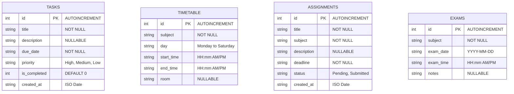

# System Architecture: Smart Student Planner

This document provides a detailed architectural specification of the **Smart Student Planner** Android application.

---

## 1. Architectural Pattern: Clean Layered Architecture

The application is structured into four decoupled layers:

```
┌────────────────────────────────────────────────────────┐
│                   Presentation Layer                   │
│   Screens (Dashboard, Tasks, Timetable, etc.)          │
│   Widgets (TaskCard, ExamCard, CustomBottomNav)        │
└───────────────────────────┬────────────────────────────┘
                            │
┌───────────────────────────▼────────────────────────────┐
│                  Service & Logic Layer                 │
│   PreferencesService (SharedPreferences)              │
│   NotificationService (flutter_local_notifications)   │
└───────────────────────────┬────────────────────────────┘
                            │
┌───────────────────────────▼────────────────────────────┐
│                    Data Model Layer                    │
│   Task, Timetable, Assignment, Exam                    │
└───────────────────────────┬────────────────────────────┘
                            │
┌───────────────────────────▼────────────────────────────┐
│                Database / Persistence Layer            │
│   DatabaseHelper (Singleton SQLite Engine)             │
│   smart_student_planner.db                             │
└────────────────────────────────────────────────────────┘
```

---

## 2. Entity-Relationship (ER) Diagram

The SQLite database (`smart_student_planner.db`) maintains four core tables:



---

## 3. State Management & Navigation Strategy

1. **`IndexedStack`**:
   - The shell host (`MainNavigationScreen`) wraps all 5 destination screens in an `IndexedStack`.
   - **Why**: Keeps all screens resident in memory. When the student changes tabs, input forms, scroll positions, and filter selections are preserved without unwanted widget disposal or rebuild overhead.
2. **Local Component State (`StatefulWidget`)**:
   - Filter chips, search text, and form inputs are managed using local `setState()` for optimal performance.
3. **Reactive SQLite Updates**:
   - Submitting an edit, completing a task, or creating an assignment triggers asynchronous queries through `DatabaseHelper.instance`, updating both the module screen and the Home Dashboard upon return.

---

## 4. Concurrency & Security

- **Parameterized Queries**: All SQL statements use `?` placeholders (e.g. `where: 'id = ?', whereArgs: [id]`), preventing SQL Injection attacks.
- **Asynchronous Worker Threading**: `sqflite` executes SQLite calls over background platform channels, preventing UI thread stutter and guaranteeing 60fps animations.
- **Singleton Pattern**: A single shared database instance prevents SQLite locking conflicts and resource leaks.
